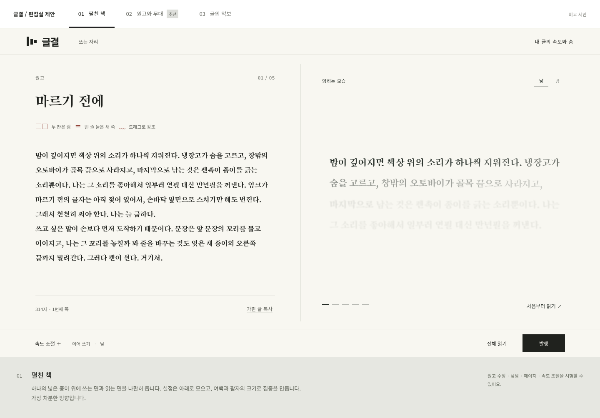
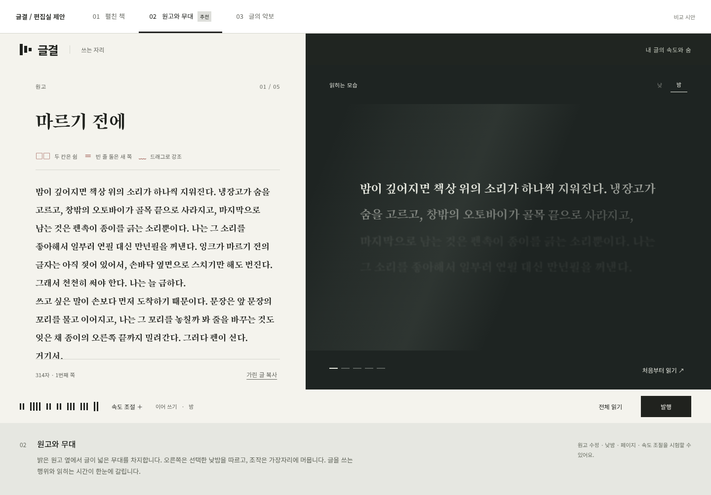
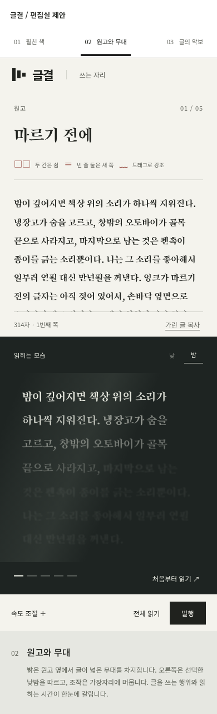
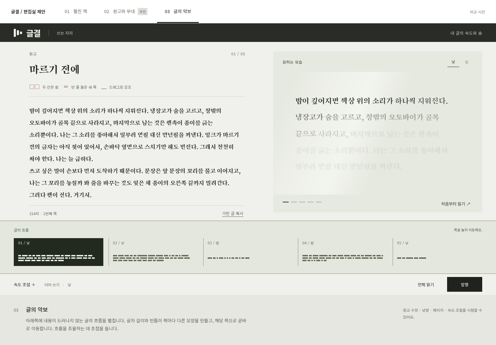

# 글결 편집실 — 디자인 제안

README의 사용자 의도, 교정쇄 명세, 현재 정적 시안을 기준으로 만든 비교안입니다. 저장소에는 서류·점·교정쇄 중 교정쇄 시안만 있어, 나머지 둘의 세부 화면은 직접 비교하지 않았습니다. 사이트 소스는 변경하지 않았습니다.

## 현재 시안에서 바꿀 지점

- 원고, 설정, 교정 부호 설명, 두 종류의 견본이 한 화면에서 비슷한 비중을 차지합니다. 펼쳐진 선택 메뉴까지 보여 주는 시안의 특성도 있지만, 실제 기본 화면에서는 원고와 읽히는 모습이 먼저 보여야 합니다.
- 작은 회색 글씨와 촘촘한 선택지가 많습니다. 모노톤을 유지하면서도 글자 크기, 공간, 밝고 어두운 면의 비율을 더 분명하게 나눌 수 있습니다.
- 마스킹과 결 무늬를 여기저기 장식으로 더하기보다, 글 길이와 빈틈을 드러내는 한 가지 일관된 표현으로 쓰는 편이 좋겠습니다.
- 재단선, 교정 부호, 공목이 모두 상시 등장할 필요는 없습니다. 쉼과 쪽 나눔은 원고에서, 효과는 선택한 부분에서, 전환은 페이지 경계에서 보여 주면 됩니다.

## 01. 펼친 책

하나의 넓은 종이를 두 면으로 사용합니다. 원고와 미리보기는 동시에 보이고, 별도 설정 열을 없앱니다. 여백과 활자의 크기로 집중을 만듭니다. 긴 글을 고치기 편한 방향이지만, 더 강한 인상을 원한다면 여전히 얌전하게 느껴질 수 있습니다.

## 02. 원고와 무대 — 추천

왼쪽 약 43%는 글을 쓰는 면, 오른쪽 약 57%는 글이 읽히는 면으로 둡니다. 미리보기의 글과 여백을 충분히 키워서, 원고를 수정하는 동안 결과의 호흡을 곁에서 느끼게 합니다. 어두운 면은 밤 장면의 예시이며 낮을 고르면 밝게 바뀝니다.

상시 설정 열을 없애고, 조작은 가장자리에 모읍니다. 규칙 세 가지는 짧게 원고 가까이에 둡니다. 다음 구현에서는 기본 흐름·장면 선택과 짧은 견본을 한 줄로 묶고, 강조와 페이지 전환은 해당 위치를 선택했을 때 열도록 권합니다. 발행과 전체 읽기는 우측 하단을 유지합니다.

이 방향은 글결의 쓰기와 읽기를 가장 또렷하게 보여 줍니다. 다만 미리보기의 어둡고 밝은 대비가 원고보다 지나치게 눈에 띄지 않도록 빛과 모션의 강도를 낮추는 것이 중요합니다.

모바일에서는 원고 아래에 미리보기를 이어 둡니다. 미리보기의 접힘과 설정 서랍은 이후 실제 작업 흐름을 보고 조정할 부분입니다.

## 03. 글의 악보

원고와 미리보기 아래에 페이지별 글의 길이와 빈틈을 펼칩니다. 내용은 가리고 형태만 남기는 표현이 탐색 기능이 됩니다. 읽는 순서와 호흡을 조율하기에 좋지만, 글쓰기보다 편집 도구를 다루는 느낌이 강해질 수 있습니다. 기본 화면에서는 접어 두고 필요할 때 펼치는 기능으로도 어울립니다.

## 제안하는 조합

02의 기본 구도를 중심으로 잡고, 03의 글 흐름은 하단에서 펼치는 도구로 둡니다. 01의 넉넉한 여백과 적은 장식을 유지합니다. 마스킹 형태는 글 흐름, 공유 카드, 작은 브랜드 표식에 일관되게 적용하고 본문 위에는 필요한 표시만 남깁니다.

## 시안의 범위

원고 수정, 낮밤, 페이지 이동, 속도 조절, 현재 쪽 전체 읽기는 비교할 수 있습니다. 움직임은 배치 확인을 위한 간단한 시연이고 기존 GeulFx 엔진을 통합한 결과가 아닙니다. 작은 미리보기는 현재 쪽 첫 문단의 첫 세 문장을 사용합니다. 강조 편집, 서버 저장, 발행은 구현하지 않았습니다.

예시 글은 저장소 index.html에서 가져왔습니다. 송명과 Noto Sans KR은 Google Fonts의 공식 글꼴을 시안에 필요한 문자로 내려받았고 라이선스는 fonts/에 함께 보관했습니다. 1440px PC와 390px 모바일에서 렌더링과 주요 조작을 확인했습니다.
